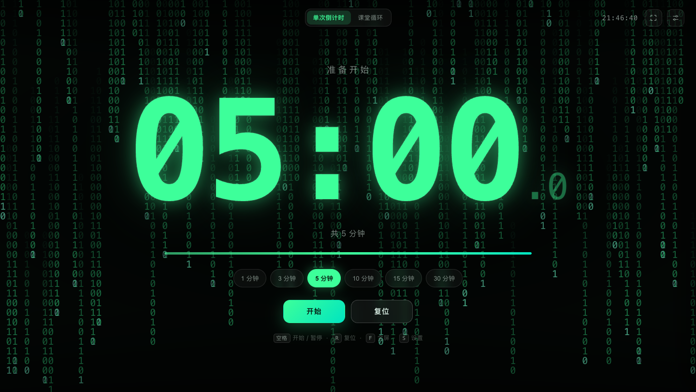
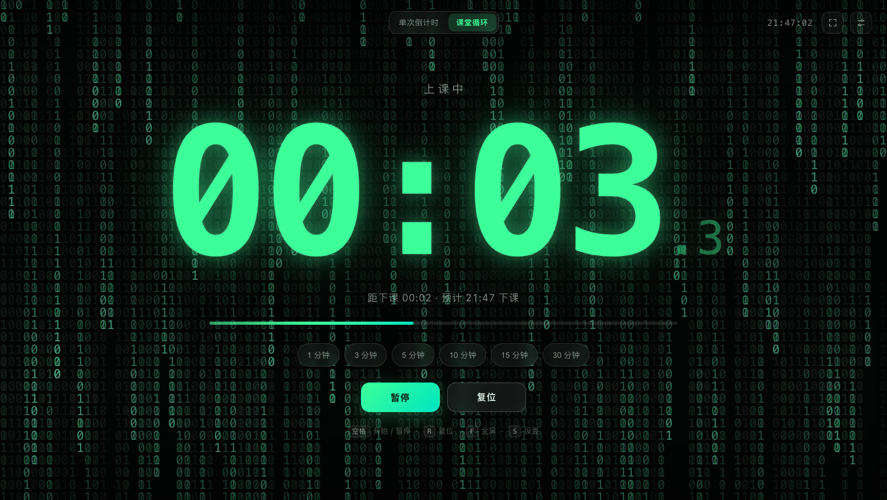
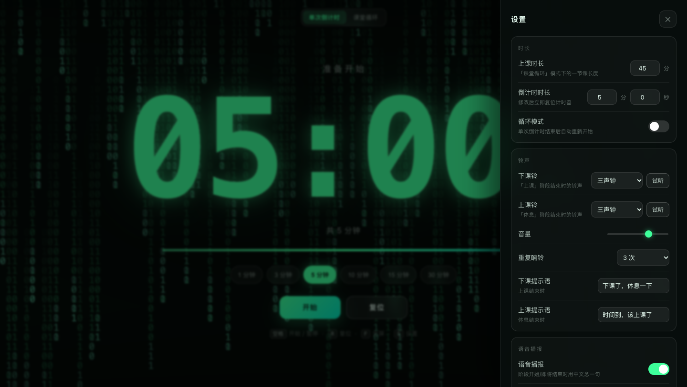
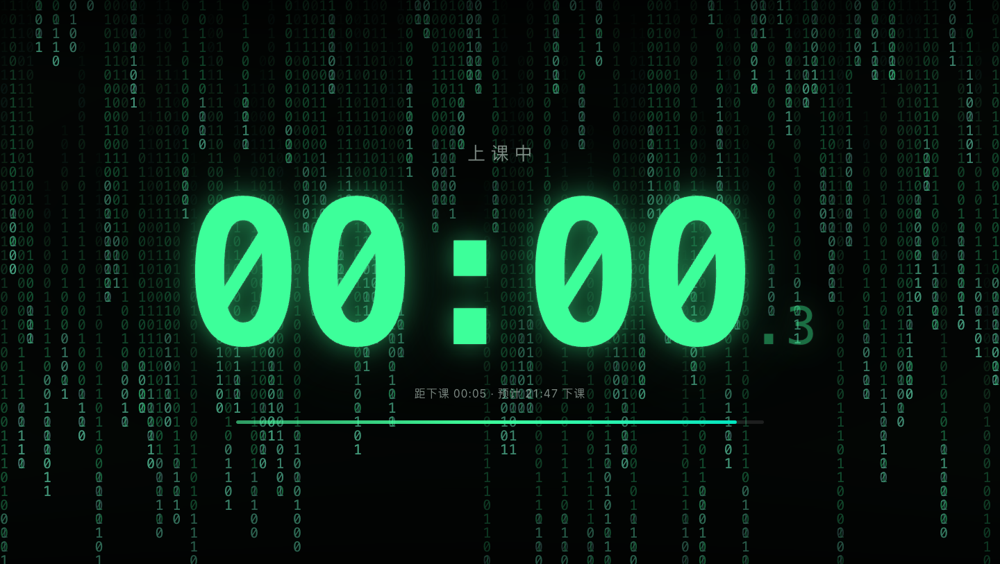
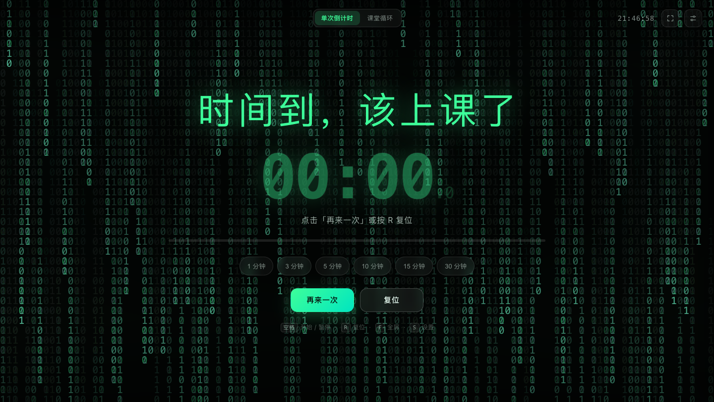

# 课件休息计时 · Class Break Timer

讲课时给学生放一段**代码雨背景的休息倒计时**。一分钟设定、精确秒级倒计时、到点响铃，投到教室大屏上不刺眼、不花哨。

一套前端代码 + Electron 外壳，同时提供 **Web / macOS / Windows** 三个端。

## 界面预览

| 主界面（单次倒计时） | 课堂循环（上课正计时） |
| --- | --- |
|  |  |

| 设置面板 | 副屏投送端（纯大字） |
| --- | --- |
|  |  |

倒计时/休息结束时用大字给出提示，课堂循环里两个阶段的文案不同（「下课了，休息一下」/「时间到，该上课了」）：



---

## 一、已实现的功能

### 核心
| 功能 | 说明 |
| --- | --- |
| 自定义倒计时 | 分 + 秒分别设置，另附 1/3/5/10/15/30 分钟快选 |
| 精确秒级显示 | 用 `performance.now()` 时间戳算剩余量（不是 `setInterval` 累加），**永不漂移**；可选显示十分之一秒 |
| 到点响铃 | WebAudio 实时合成，无需任何音频文件；三种铃声（三声钟 / 校园电铃 / 三连提示），可调音量、可重复 1~5 次 |
| 动态代码雨背景 | Canvas 矩阵雨，**默认 0/1 二进制**（投影上最容易辨认），可切换片假名 / 混合；5 套配色主题，速度与密度可调，可整体关闭 |
| 全屏投影模式 | 点击「开始」自动进入全屏并隐藏控件（0.9 秒后淡出，动鼠标重新出现）；全屏中**点击空白或按 Esc 退出全屏，计时不停** |

### 课堂循环（双阶段自动衔接）
一节课的完整节奏，按一次键就能自己跑完：

```
上课（正计时，可设 45 分钟）──到点响下课铃──▶ 休息（倒计时，可设 10 分钟）──到点响上课铃──▶ 上课…
```

- 上课阶段大字显示**已上课时长**（正计时），副标题给出「距下课 03:12 · 预计 11:35 下课」
- 两个阶段可分别设置铃声：下课铃 / 上课铃
- 两个阶段也有各自的提示语：上课结束时大字显示「下课了，休息一下」，休息结束时显示「时间到，该上课了」（都可自定义）
- 阶段切换时语音播报同一句提示语
- 随时可以暂停、复位、手动进入下一阶段

### 语音播报
用系统原生的中文 TTS（Web Speech API，无需联网）：

- 阶段开始：「开始上课，45 分钟」「下课了，休息 10 分钟」
- 结束前（30 秒 / 1 / 2 / 5 分钟可选）：「距离下课还有一分钟」
- 语速可调，可整体关闭

### 副屏投送
老师笔记本上操作，第二块屏（投影 / 讲台副屏）全屏显示**纯大字画面**：

- 桌面端：点右上角显示器图标（或 `⌘/Ctrl + Shift + M`），自动找第二块屏全屏显示，画面通过 IPC 实时同步，Esc 退出
- Web 端：另开一个标签页访问 `index.html#mirror`，同一浏览器内通过 `BroadcastChannel` 同步
- 投屏端没有任何按钮，只有代码雨 + 大字 + 进度条

### 课堂实用细节
- **结束前变色提醒**：最后 5/10/20/30/60 秒数字变红闪烁，可选每秒滴答声
- **预计结束时间**：运行时显示「预计 15:16 结束」，方便老师对表
- **进度条**：一眼看出还剩多少比例
- **提示语可自定义**：下课「下课了，休息一下」、上课「时间到，该上课了」，单次倒计时模式用后者
- **单次循环模式**：单次倒计时结束后 4 秒自动重开（适合连堂）
- **设置自动保存**：时长、铃声、主题等重启后仍在（localStorage）
- **当前时钟**：右上角常显
- **快捷键**：`空格` 开始/暂停 · `R` 复位 · `F` 全屏 · `S` 设置 · `M` 投屏 · `Esc` 退出全屏/关闭面板；全屏中点击空白也可退出全屏

### 桌面端专属
- **系统托盘常驻**：关闭窗口不退出，收进托盘；托盘菜单可直接开始/暂停、复位、投屏
- **全局快捷键**（应用在后台也生效）：`⌘/Ctrl+Shift+Space` 开始/暂停，`⌘/Ctrl+Shift+R` 复位，`⌘/Ctrl+Shift+M` 投屏
- 窗口置顶（投影时不被 PPT、浏览器挡住）
- 倒计时期间**阻止屏幕休眠**（Web 端用 Wake Lock API，桌面端用 `powerSaveBlocker`）
- 窗口失焦、隐藏到托盘仍然全帧率计时（`backgroundThrottling: false`）
- 单实例锁、原生菜单、macOS 隐藏式标题栏

---

## 二、快速开始

### Web 端（零依赖）
直接用浏览器打开 `index.html` 即可。要部署到服务器/内网：

```bash
cd class-break-timer
python3 -m http.server 8080
# 浏览器访问 http://localhost:8080
```

> 建议用 Chrome / Edge。首次点击「开始」时浏览器才允许出声，这是浏览器的自动播放策略，不是 bug。
>
> 想用「副屏投送」但没装桌面端？用 `http://` 打开（不要用 `file://`），再开一个标签页访问 `index.html#mirror`，两个标签页会通过 `BroadcastChannel` 同步。

### macOS / Windows 桌面端

```bash
cd class-break-timer
npm install          # 国内建议先设镜像：
                     # export ELECTRON_MIRROR=https://npmmirror.com/mirrors/electron/
npm start            # 本地运行调试
```

打包安装包：

```bash
npm run pack:mac     # dist/ 下的 .dmg + .zip（arm64 / x64）
npm run pack:win     # dist/ 下的安装包 + 免安装版（x64）
```

打包产物（`dist/`）：

| 文件 | 用途 |
| --- | --- |
| `ClassBreakTimer-1.0.0-mac-arm64.zip` | macOS（Apple Silicon）解压即用的 .app |
| `ClassBreakTimer-1.0.0-mac-x64.zip` | macOS（Intel）解压即用的 .app |
| `ClassBreakTimer-1.0.0-win-x64-setup.exe` | Windows 安装包（含桌面快捷方式、可卸载） |
| `ClassBreakTimer-1.0.0-win-x64-portable.exe` | Windows 免安装单文件版 |

> ⚠️ **跨平台打包限制**：macOS 上可直接打 mac 包；Windows 包 electron-builder 会自动下载 wine 完成（本机已验证可打）。若遇到问题，也可跑 `.github/workflows/build.yml`（推 `v*` tag 自动产出双平台）。

打包产物默认未签名：
- macOS 首次打开需右键 →「打开」，或执行 `xattr -dr com.apple.quarantine /Applications/课件休息计时.app`
- Windows 首次运行 SmartScreen 会提示，点「更多信息 → 仍要运行」

---

## 三、目录结构

```
class-break-timer/
├── index.html              # 全部界面 + 样式 + 逻辑（无外部依赖，可直接双击打开）
├── main.js                 # Electron 主进程：窗口、菜单、托盘、副屏窗口、置顶、防休眠
├── preload.js              # 预加载桥接（contextIsolation 安全模式）
├── package.json            # 依赖 + electron-builder 打包配置
├── build/icon.png          # 应用图标（1024²，electron-builder 自动转 icns/ico）
├── docs/                   # 界面预览截图
├── scripts/
│   ├── make-icon.py        # 重新生成图标
│   └── e2e-check.js        # 用 CDP 驱动双页面做交互回归 + 截图
└── .github/workflows/build.yml   # 双平台自动打包
```

技术选型说明：**没有用框架、没有构建步骤**。整个 Web 端是一个 HTML 文件，拷到任何电脑双击就能用——教室里最怕的就是"装不上、跑不起来"。

---

## 四、下一步可以加什么

已经落地的三项（课堂循环、语音播报、副屏投送 + 托盘）见上文。再往后按课堂价值排序：

1. **课表预设** —— 按星期 + 节次记住不同时长（上午大课间 20 分钟、下午 10 分钟），一键切换，不用每次改数字。
2. **环境音** —— 休息时放白噪音 / 轻音乐，随倒计时淡入淡出，比纯静音更放松。
3. **遥控支持** —— 把 PageUp/PageDown、蓝牙翻页笔按键映射成开始/暂停，老师走动着也能控制。
4. **结束提示卡片** —— 铃声后弹出「下节课：数学 · 请准备课本」，提前预告。
5. **局域网广播铃** —— 一台电脑响铃，同网段所有设备同步（需要一个几十行的 WebSocket 服务）。
6. **休息统计** —— 记录每次实际休息时长，月底看看自己拖堂了几次（笑）。
7. **投影适配助手** —— 按屏幕尺寸自动调字号，并做对比度检测，避免后排看不清。

---

## 五、开发备注

- **计时准确性**：核心循环是 `requestAnimationFrame` + `endAt` 时间戳，`dt` 只用于动画。切到后台标签页被节流时，回到前台会立即用时间戳校正，不会"少走"；另有 `setTimeout` 兜底，页面被隐藏时也能按时响铃。
- **状态机**：只有 `timer.phase`（class / break）和 `running / finished` 三个维度，`remaining` 在两个阶段里都表示「本阶段还剩多少」，所以上课的正计时 = `total - remaining`，一套渲染逻辑覆盖两种模式。
- **代码雨性能**：单 canvas、`fillRect` 半透明拖尾、无 `shadowBlur`，1080p / 4K 投影都稳。DPR 上限 2，避免 4K 屏上过度绘制。
- **音频**：全部用振荡器合成，`AudioContext` 在用户点击「开始」时才创建/恢复，兼容各浏览器的自动播放策略。
- **跨窗口同步**：状态由主窗口以 ~8Hz 广播，投屏端收到基准值后自己按 `performance.now()` 插值到每帧，所以十分之一秒也是平滑的。桌面端走 IPC，Web 端走 `BroadcastChannel`，同一套消息格式。
- **调试钩子**：`index.html?debug=1` 会在 `window.__cbt` 暴露 `timer / S / setPhase / start`，方便自动化测试把「45 分钟一节课」压缩成 6 秒来跑。
- **回归测试**（需要先起本地 http 服务）：

```bash
python3 -m http.server 8123
node scripts/e2e-check.js http://127.0.0.1:8123
```

  会启动无头 Chrome，跑完「设置 → 倒计时 → 暂停 → 结束 → 切课堂循环 → 上课/下课自动衔接 → 开投屏端并校验两端读数一致」，截图落在 `/tmp/cbt2-*.png`。

MIT License
